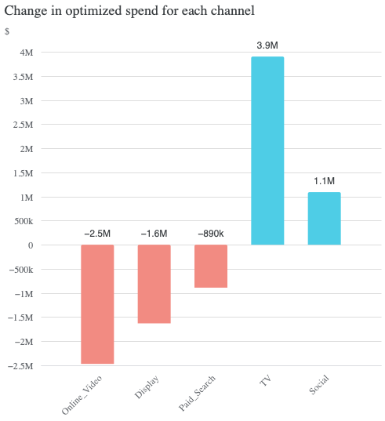
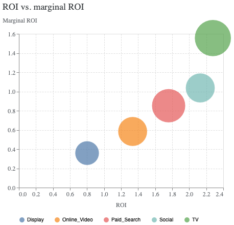
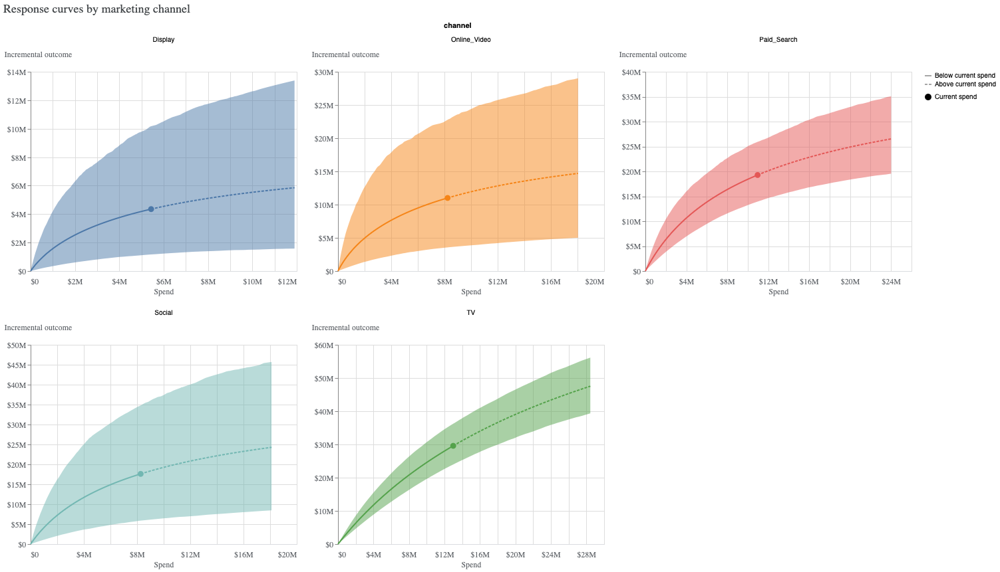
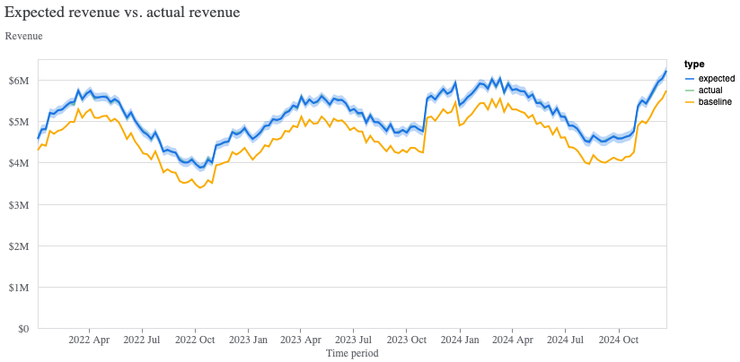

# Marketing Mix Model with Google Meridian

A Bayesian Marketing Mix Model (MMM) for a CPG brand, built with Google's open-source **Meridian** library. It measures the ROI of five media channels across 20 regions and recommends a budget reallocation that grows media-driven revenue by **4.2% at the same total spend**.

---

## Business question

> "We spend about $46M a year across TV, Paid Search, Social, Online Video and Display. Which channels are actually driving sales, and how should we split next year's budget?"

## Key results

| Channel | Share of spend | ROI (90% credible interval) | Marginal ROI | Recommendation |
|---|---|---|---|---|
| TV | 28% | **2.28** (1.85 – 2.79) | 1.5 | Increase +30% |
| Paid Search | 24% | 1.76 (1.27 – 2.37) | 0.9 | Trim −8% |
| Social | 18% | 2.13 (0.71 – 4.21) | 1.0 | Increase +13%, validate with a geo test |
| Online Video | 18% | 1.34 (0.43 – 2.76) | 0.6 | Reduce −30% |
| Display | 12% | **0.80** (0.21 – 1.87) | 0.4 | Reduce −30% |

- **Budget optimization:** with the same $45.9M budget, media-driven revenue rises from **$81.8M to $85.3M (+4.2%, about $3.5M)**.
- **TV** has the highest ROI and still has headroom on its response curve. **Display** returns less than $1 per $1 spent.
- **Social** has a very wide uncertainty range. I'd recommend running a geo-holdout experiment before scaling it.

## Data

Synthetic weekly data for a CPG brand: **20 regions × 156 weeks (3 years) = 3,120 rows**.

- **KPI:** units sold, converted to revenue using average price
- **Media spend:** TV, Paid Search, Social, Online Video, Display, with on/off flighting
- **Controls:** shelf price, promotion depth, distribution (%), competitor price, plus seasonality and trend

The data was generated with known adstock, saturation and ROI values for each channel. This gives a **ground truth** to test whether the model recovers the real effects, which isn't possible with real client data.

## Approach

1. **Exploratory analysis:** trends, seasonality, budget mix and correlations. Correlation alone ranked channels wrongly: Display looked strong and TV looked weak.
2. **Baseline regressions:**
   - Spend-only OLS gave Display an ROI of about 21, which is badly inflated by confounding.
   - Adding controls and region fixed effects gave R² 0.93 but **negative ROIs** for three channels. A high R² doesn't mean the ROIs are right.
   - Adding adstock and Hill saturation, tuned with a grid search per channel, fixed the signs and recovered TV's long carryover (0.7) and Search's short one (0.1).
3. **Bayesian MMM in Meridian:**
   - Geo-level hierarchical model with geometric adstock and Hill saturation
   - Priors on ROI, with MCMC sampling (4 chains × 500 draws)
   - Time-varying baseline with 12 knots
4. **Validation:**
   - Convergence: R-hat below 1.1 for all parameters
   - Fit: R² of 0.98 and MAPE of 4.2% at region level
   - Ground-truth check: the 90% credible interval contains the true ROI for 4 of 5 channels
5. **Optimization:** response curves, marginal ROI, and a fixed-budget optimizer with ±30% guardrails per channel.

## Model vs ground truth

| Channel | True ROI | Regression (adstock + saturation) | Meridian (mean) |
|---|---|---|---|
| TV | 2.86 | 2.54 | 2.28 |
| Paid Search | 2.06 | 1.87 | 1.76 |
| Social | 1.55 | 2.32 | 2.13 |
| Online Video | 1.66 | 1.55 | 1.34 |
| Display | 0.56 | 0.69 | 0.80 |

Both models rank TV first and Display last. Meridian adds what a point estimate can't: an uncertainty range for every channel, showing where the data is strong (TV, Search) and where it isn't (Social, Display).

## Limitations and next steps

- Spend is used as the exposure measure. With real data, impressions or GRPs would be better.
- Priors are Meridian defaults. ROI priors could be calibrated with lift tests or past studies.
- Social is overestimated, and its interval is wide. A geo experiment would sharpen that estimate.

## Tools

Python · Google Meridian 2.1 · TensorFlow Probability (MCMC) · pandas · NumPy · statsmodels · Altair · Google Colab

## Files

| File | Description |
|---|---|
| `MMM_Meridian_Project.ipynb` | Full notebook: data generation, EDA, regressions, Meridian model, optimization |
| `cpg_mmm_synthetic.csv` | Dataset (3,120 rows) |
| `images/` | Charts used in this README |

---

**Kritika Patil** · [Portfolio](https://kritikanpatil68.github.io) · [LinkedIn](https://www.linkedin.com/in/kritika-patil-a21aa3185/)
